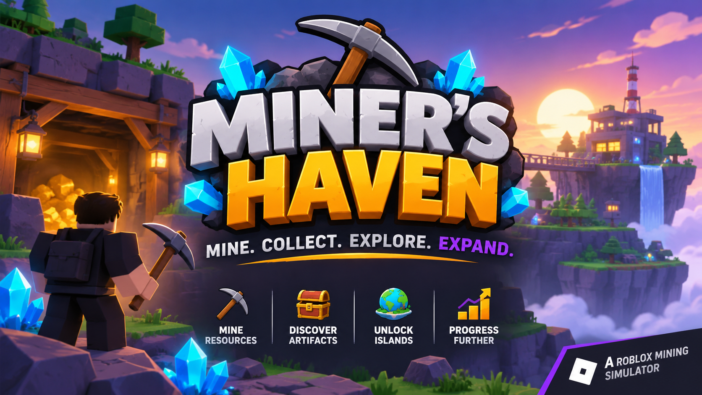

# ⛏️ Miner's Haven

**MINE. COLLECT. EXPLORE. EXPAND.**

A collaborative Roblox island mining simulator built around resource collection, artifact discovery and island progression.

## 🎮 About the Game

Miner's Haven is a multiplayer island-based mining simulator where players explore different islands, mine resource deposits, discover rare artifacts, sell their findings and progress through increasingly advanced areas.

The game focuses on three main pillars:

- **Mining:** Gather ores and resources from mining deposits.
- **Discovery:** Find valuable artifacts hidden inside deposits.
- **Progression:** Upgrade equipment, expand collections and unlock new islands.

## 🔄 Core Gameplay Loop

1. **Explore** – Visit your current island and discover mining areas.
2. **Mine** – Use pickaxes to break resource deposits.
3. **Collect** – Gather ores and discover hidden artifacts.
4. **Sell** – Convert collected resources into currency.
5. **Upgrade** – Improve equipment and mining capabilities.
6. **Progress** – Unlock additional islands and continue exploring.

## ⚙️ Gameplay Systems

### Mining & Deposit Spawning

- Pickaxe-based mining mechanics.
- Resource deposits spawn at designated locations.
- Deposits are prevented from overlapping.
- Approximately 5–10 active deposits can exist at once.
- New deposits can spawn as existing ones are mined.
- Artifacts can be hidden inside deposits.

### Ore & Resource Collection

Players collect resources through mining, creating the foundation for the game's economy and progression.

### Artifact Discovery

Artifacts are hidden inside mining deposits and can be discovered during mining.

**Artifact Collection**

| Rarity | Artifacts |
|---|---|
| Common | Forgotten Coin, Stone Figurine, Rusty Key |
| Uncommon | Ceremonial Mask |
| Rare | Golden Idol, Timekeeper |
| Legendary | Void Relic, All-Seeing Eye |

### Artifact Index

A collection system that permanently records discovered artifacts.

- Tracks discovered artifacts.
- Supports permanent buffs.
- Encourages players to explore and complete their collections.

### Inventory System

Stores collected ores, resources and artifacts, connecting mining with resource management and selling.

### Selling System

Allows players to convert collected resources into currency for further progression.

### Pickaxe Progression

Players can obtain and progress through better pickaxes to improve their mining capabilities.

### Island Progression

- Players begin on a starter island.
- Additional islands unlock through progression.
- Each island has its own mining area.
- Previously unlocked islands remain accessible.

### Minions

Planned automated mining companions that will help players automate part of their mining gameplay.

## 🛠️ Development Status

<strong>Completed Systems</strong>

- Mining mechanics
- Deposit spawning
- Ore collection
- Artifact discovery
- Inventory management
- Selling system
- Pickaxe progression and upgrades
- Artifact Index
- Permanent artifact buffs
- Island progression

<strong>Currently In Development</strong>

- Island map and world building
- Shop system
- Minion system

## 🗺️ Development Roadmap

| Phase | Focus |
|---|---|
| 1 | Complete island environments |
| 2 | Finish the shop system |
| 3 | Develop the minion system |
| 4 | UI polish and integration |
| 5 | Gameplay balancing and testing |

## 👥 Development Team

Miner's Haven is a jointly owned project developed by a two-person team with equal 50/50 ownership.

| Developer | Responsibilities |
|---|---|
| **Samir Israr** | Lead Programmer, UI Developer |
| **Enzo** | Builder, UI Developer |

Both developers contribute to UI development, game direction and overall project decisions.

**Project Ownership: 50/50**

### Contact

- **Samir:** [GitHub Profile](https://github.com/Samir-Israr)
- **Enzo:** Discord `@enzoface21_`

## 💻 Technologies

- Roblox Studio
- Luau
- Roblox UI Development

---

*Miner's Haven is an ongoing collaborative game development project.*
